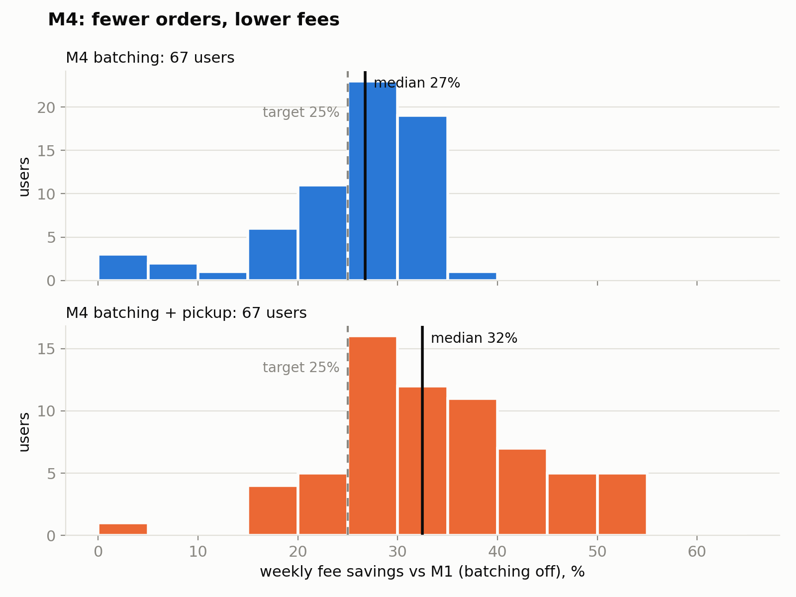

# 🍽️ WEEKLIES — Intelligent Meal Planning and Delivery System
[](https://github.com/billameen/ncsu-csc510-2025-s1-g3-weeklies/actions/workflows/ci.yml)
[](https://github.com/billameen/ncsu-csc510-2025-s1-g3-weeklies/actions/workflows/docs.yml)
[]()
[](https://flask.palletsprojects.com/)
[](LICENSE)
[](https://github.com/billameen/ncsu-csc510-2025-s1-g3-weeklies/commits)
[](https://github.com/billameen/ncsu-csc510-2025-s1-g3-weeklies/issues)
[](https://github.com/billameen/ncsu-csc510-2025-s1-g3-weeklies/pulls)
[](https://github.com/psf/black)
[](https://github.com/astral-sh/ruff)

---

## 🧠 Project Overview

**Weeklies** is a full-stack Flask web application for planning and ordering a week of meals.
Users register, set dietary preferences, allergies, a daily calorie target and a weekly budget,
browse restaurants and menus, and schedule orders on a calendar. A constraint solver plans all 21
meals of their week at once so that every day hits the calorie target, the week fits the budget,
and no meal contains their allergens.

This repository is our team's continuation of Weeklies for *CSC 510: Software Engineering
(NC State University)*. We are extending the existing application with a new set of milestones
(see [Roadmap](#️-roadmap)), while keeping the codebase tested, documented, and continuously integrated.

> **Built on Weeklies (Fall 2025).** This project starts from the
> [Weeklies codebase](https://github.com/Aum3010/ncsu-csc510-2025-s1-g3-weeklies) by Aum Pandya,
> Pranav Bhagwat, and Tayo Olukotun, which itself extended earlier work by Section 001 Group 9
> (Taylor J. Brown, Kunal Jindal, Ashritha Bugada, Daniel Dong). Thank you to both teams.

---

## 🗺️ Roadmap

<!-- TODO: replace with our milestones once finalized -->
| # | Milestone | Status |
|---|-----------|--------|
| 1 | _TBD_ | ⏳ Planned |
| 2 | _TBD_ | ⏳ Planned |
| 3 | _TBD_ | ⏳ Planned |
| 4 | _TBD_ | ⏳ Planned |

---

## 📊 Meal Planner Results

Since M1 the week is planned by an OR-Tools CP-SAT solver instead of an LLM
([why](app/docs/why-a-solver.md)). Every rule is a plug-in
([add one in 15 minutes](app/docs/planner-rules.md)). M0 evaluation, 100 simulated users,
seed 510 ([full results](eval/results/m0.md), [method](app/docs/evaluation.md)):

| | Target | v1 LLM (B2) | Solver (M1) |
|---|---|---|---|
| H1 Feasible users who get a valid week | ≥ 90% | 0% | **100%** |
| H2 Distinct items per week (median) | ≥ 14 | 19 | **20** |
| H3 Time to plan a week (p95) | ≤ 5 s | 216 s | **2.8 s** |
| H4 Infeasible users told "no valid week" | ≥ 90% | 0% | **100%** |
| Infeasible users told why | 100% | 0% | **100%** |

Reproduce with `python -m eval.run --seed 510` (about 3 minutes, no API key). `PLANNER=llm` switches
`/generate_plan` back to v1.

### M4: fee-aware batching

Every meal used to be its own delivery order, so a 21-meal week paid **$115.08** in fees
($3.99 delivery + $1.49 service, 21 times) before any food. M4 counts fees per *order*
([`planner/rules/fee_cost.py`](app/planner/rules/fee_cost.py)):

- **Batching** (opt-in): meals from the same restaurant on the same day, at most 6 hours apart
  (breakfast + lunch, or lunch + dinner), share one delivery. That 21-meal week drops to 14
  orders: **$115.08 → $76.72**.
- **Pickup** (opt-in per restaurant *and* day): no delivery fee.
- Fees count toward the weekly budget, so batching can make a budget M1 called impossible fit.

> **The fees are a synthetic model**, not real prices: the seed data gives each restaurant a
> made-up delivery fee from $1.99 to $5.99 ([`planner/fees.py`](app/planner/fees.py)).

M0's 100 users, seed 510, against M1 with batching off ([full results](eval/results/m4.md)):

| Target | Goal | M4 batching | M4 batching + pickup¹ |
|---|---|---|---|
| Median weekly fee savings vs M1 | ≥ 25% | **26.8%** ✅ | **32.5%** ✅ |
| Valid-week rate | no drop vs M1 (67%) | **74%** ✅ | **74%** ✅ |
| Variety (median distinct items) | drop ≤ 2 vs M1 (20) | **19** (−1) ✅ | **19** (−1) ✅ |
| Food-safety window violations | 0 | **0** ✅ | **0** ✅ |
| Budgets only possible with batching | report | **7 users** | **7 users** |

Median fees fall from $98.58 to $71.96 a week (21 → 15 orders); the median user pays $106.08 →
$77.70. No user loses a valid week, and the validator, which recomputes every order's fees on
its own, agrees with the planner on all of them.



¹ Pickup opt-ins are synthetic: half the users opt into pickup at 5 restaurants on the weekend
and one weekday. Reproduce with `python -m eval.m4 --seed 510` (about 10 minutes; resumes if
stopped). The M0 table above was measured before M4 gave restaurants their own fees; rerun
`python -m eval.run --seed 510` to refresh it.

---

## 🧩 What We Started From

Features inherited from Weeklies (Fall 2025):

- 👤 **User registration & authentication**
- 🍱 **Restaurant and menu browsing** with allergen and cuisine tagging
- 🧭 **User preference tagging** and filtering
- 📅 **Calendar-based order scheduling**
- 🤖 **LLM-generated weekly meal plans** (OpenAI, or a local HuggingFace model as fallback)
- 💰 **Wallet system** for paying, topping up, and gifting balance
- ⭐ **Restaurant reviews and ratings**
- 📈 **User insights dashboard** for dining and spending history
- ⚙️ **Admin dashboard** for managing orders and order status
- ✉️ **Support ticket system**
- 🧾 **PDF order receipts**

---

## ⚙️ Tech Stack

| Layer | Technologies |
|-------|--------------|
| **Frontend** | Server-rendered Jinja2 templates, plain HTML/CSS/JavaScript |
| **Backend** | Python 3.11+, Flask |
| **Database** | SQLite via raw `sqlite3` (helpers in `app/sqlQueries.py`) |
| **Meal planner** | OR-Tools CP-SAT constraint solver (`app/planner/`) |
| **LLM** | OpenAI API (`gpt-4o-mini`) or local HuggingFace model (v1 planner, `PLANNER=llm`) |
| **PDF** | ReportLab |
| **Tooling** | GitHub Actions, pytest, pytest-cov, ruff, black, pdoc |

---

## 🧱 Repository Layout

```
.
├── app/
│   ├── Flask_app.py          # all routes and helpers
│   ├── sqlQueries.py         # DB access helpers
│   ├── planner/              # CP-SAT weekly planner; rules/ holds one plug-in per rule
│   ├── menu_generation.py    # v1 LLM meal-plan generation (PLANNER=llm)
│   ├── llm_toolkit.py        # LLM provider wrapper
│   ├── pdf_receipt.py        # receipt PDFs
│   ├── models.py
│   ├── templates/  static/
│   ├── db/seed.sql           # schema + demo data (source of truth for the local DB)
│   ├── scripts/init_db.py    # builds app/CSC510_DB.db from db/seed.sql
│   ├── migrations/           # one-off, idempotent schema changes
│   ├── tests/                # smoke / unit / integration / e2e / llm / planner / eval
│   ├── docs/                 # architecture, evaluation, planner rules, why a solver
│   └── requirements.txt
├── eval/                     # M0 evaluation: validator, simulated users, planners, results
├── .github/workflows/        # ci.yml (tests), eval.yml (M0 eval), docs.yml (pdoc → GitHub Pages)
├── scripts/build_docs.py
├── INSTALLATION.md  CONTRIBUTING.md
├── pytest.ini  pyproject.toml  .coveragerc  pdoc.toml
└── README.md
```

---

## 🚀 Installation & Usage

See the **[Installation Guide](./INSTALLATION.md)** for environment setup, building the local
database, running the app, and running tests.

---

## 🧪 Continuous Integration

Every push or pull request to `main` or `development` runs the test suite with coverage
(`.github/workflows/ci.yml`). Pushes to `main` also build the pdoc API documentation and deploy it
to GitHub Pages (`.github/workflows/docs.yml`).

---

## 📚 Documentation

API documentation is generated with **pdoc**. To build it locally, see
[INSTALLATION.md](./INSTALLATION.md#documentation).

---

## 👥 Team

Developed as part of **CSC 510: Software Engineering, NC State University**.

<!-- TODO: fill in team members -->
| Member | GitHub Handle | Key Contributions |
|--------|---------------|-------------------|
| _TBD_ | [@billameen](https://github.com/billameen) | _TBD_ |

---

## 🤝 Contributing

Please review our [Code of Conduct](CODE_OF_CONDUCT.md) before submitting pull requests. Branch off
`development` and open PRs back into `development`. See [CONTRIBUTING.md](CONTRIBUTING.md), including
how to extend the meal planner safely.

---

## 📜 License

Distributed under the MIT License. See [LICENSE](./LICENSE) for more information.
